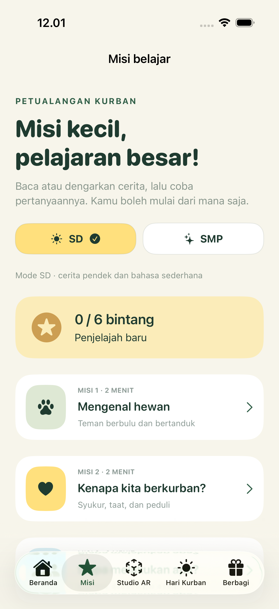
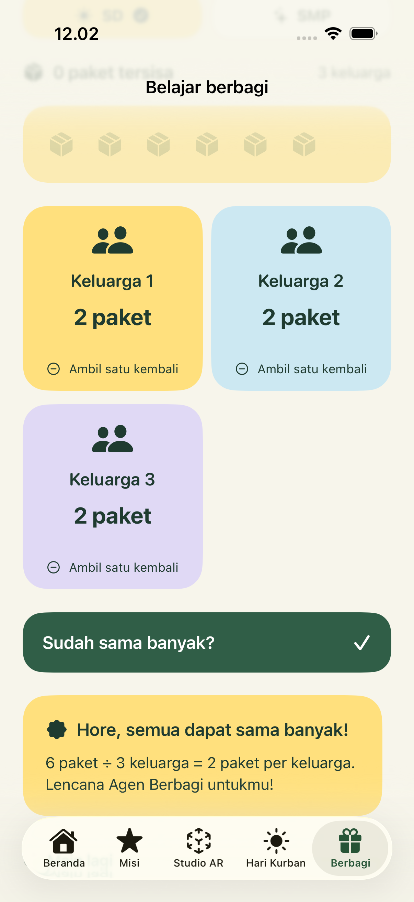

# KurbanAR

**Pahami maknanya. Rasakan dekatnya.**

An Indonesian, offline-first iPhone and iPad experience exploring kurban through care, preparation, interactive 3D, and sharing. Built with SwiftUI, RealityKit, and ARKit. No third-party runtime dependencies, accounts, analytics, or downloaded 3D assets. Original models are generated with Blender; the reproducible source is in `tools/create_animals.py`.

 

## Try it

1. Open `KurbanAR.xcodeproj` in Xcode 16 or newer (iOS 18+ deployment target).
2. Select the **KurbanAR** scheme and an iPhone/iPad simulator; run.
3. For camera AR, select an ARKit-compatible physical device and configure your own signing team in Signing & Capabilities.

The simulator provides interactive 3D. Camera AR is available only on compatible physical devices, after camera permission is granted. Move the camera slowly to detect a horizontal plane, tap to place the sheep, pinch to resize, and use two fingers to rotate. Use **Letakkan ulang** to place it again.

## Version 0.3 · A learning adventure for SD and SMP

The learning experience now centers on children exploring kurban with a parent or teacher.

- **SD / SMP learning modes**: short story pages for both, with optional extra context for SMP. No name, school, birth date, or exact age is requested.
- **Six missions** about animals, the meaning of kurban, the panitia team, observing with empathy, the overall process, and sharing. One persistent star per completed mission; replaying does not inflate rewards. Completion from version 0.2 is retained.
- **Listen to stories** with the system's Indonesian speech synthesis voice. Availability and pronunciation depend on the installed system voices; text remains available.
- **Hari Kurban**: five symbolic stations, an optional textual explanation of slaughter, and a tap-to-order activity. No slaughter visuals, cutting gestures, or graphic content. Skipping the optional explanation does not change the reward.
- **Sharing game**: give six pretend packages to three families in SD mode, or twelve to four in SMP mode. Take back packages and retry; finish when all packages are distributed equally. The original gram calculator remains available as a separate optional activity.
- **Companion guide** with discussion prompts, viewing choices, privacy notes, and an AR introduction. The previous outward reference links have been removed from the app's information screen.
- No ads, chat, purchases, social rankings, pressure mechanics, or automatic narration.

This is still a prototype. Educator, religious, child-usability, and App Store category reviews remain pending. The AR companion acknowledgement is not a verified parental-consent mechanism or a reviewed Kids Category parental gate.

## Version 0.2 · Spatial animal studio

- A full-screen, forest-green 3D exhibit with warm lighting, contact shadows, a display plinth, and gentle auto-orbit.
- **Sapi and domba selection**, shared between home and studio and remembered locally.
- New original USDZ meshes: a chestnut cattle model and a woolly ram with curved horns, muzzles, ears, and cloven hooves. More natural proportions; still illustrative, not photorealistic scans.
- One-finger orbit, pinch to zoom, pause/resume, reset view, and head/body/feet observation markers.
- Full-screen camera AR, explicit camera-feed background, session start after the view is mounted, surface detection feedback, and a restart action.
- Camera permission handling that preserves activation across the permission dialog's temporary inactive state. A no-frame timeout replaces indefinite silent waiting.
- Visible model loading state and simulator-specific camera guidance.

**Physical-camera verification remains pending.** The updated signed app was installed on the connected iPhone 13, but its camera session was not tested. Simulator results do not establish that the reported physical-device blank screen is resolved.

## Prototype features

- Warm cream and forest-green SwiftUI interface with responsive iPad content widths.
- Six short learning missions with questions, feedback, and persistent local progress.
- Original cattle and ram USDZ assets rendered in RealityKit, both in 3D preview and camera AR.
- Explicit camera consent, denied-permission handling, session interruption feedback, and preview fallback.
- Distribution calculator using integer grams: equal package weight plus a visible remainder.
- In-app companion guide and privacy explanation.

## Validation

```sh
swift test
xcodebuild -project KurbanAR.xcodeproj -scheme KurbanAR \
  -destination 'generic/platform=iOS Simulator' CODE_SIGNING_ALLOWED=NO build
```

To run the UI smoke tests, use Product → Test in Xcode with the KurbanAR scheme and an iPhone simulator.

Nine core tests cover process ordering, sharing-game invariants, legacy progress, the animal catalog, camera activation policy, and conservation of total weight, remainder bounds, invalid inputs, and progress persistence. See [verification notes](docs/VERIFICATION.md) for device-specific checks.

## Structure

```text
KurbanAR/App/          Entry point, shared UI, navigation
KurbanAR/Features/     Home, missions, Hari Kurban, studio, sharing
KurbanAR/AR/           Procedural model and AR session integration
Sources/KurbanCore/   Learning content, progress, distribution logic
Tests/                Swift Testing domain tests
UITests/              XCUITest navigation, games, studio, and persistence checks
docs/                 Privacy, editorial and release preparation
```

The Xcode target compiles the core source files directly; the Swift package exposes the same sources for standalone tests.

## Editorial status

This is an early personal portfolio prototype, **not a released App Store product**. Content requires review by qualified religious and animal-health reviewers before public distribution. The animals are illustrative and cannot assess animal eligibility, age, health, or real-world dimensions. Distribution numbers are arithmetic exercises using ready-to-pack meat, not live-animal yield estimates or religious allocation rules.

There are no depictions of slaughter. The focus is care, organization, and sharing. See [release preparation](docs/RELEASE.md) and [privacy](docs/PRIVACY.md).

## Further reading

- [Kemenag: preparing kurban distribution](https://dki.kemenag.go.id/berita/panitia-qurban-kankemenag-jakarta-utara-matangkan-distribusi-daging-kurban-pEvCv)
- [Kementan: animal welfare guidance](https://repository.pertanian.go.id/server/api/core/bitstreams/36d3973f-8871-4070-80d4-8a5b763cda69/content)
- [Apple App Review Guidelines](https://developer.apple.com/app-store/review/guidelines/)

These are background reading, not endorsements or evidence of expert approval.
