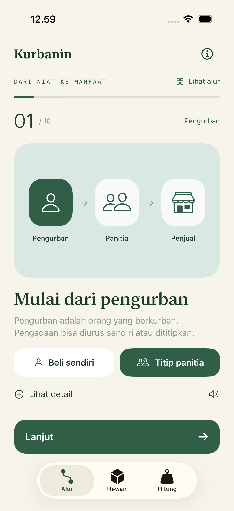
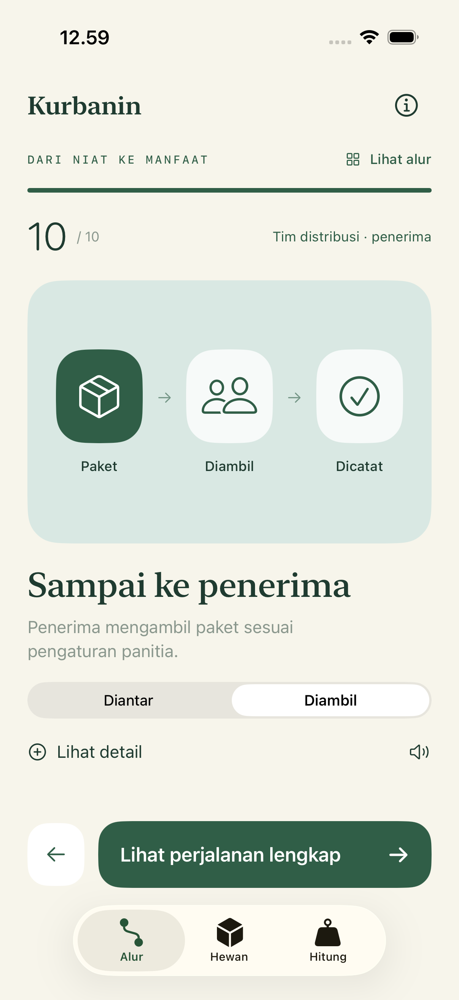

# Kurbanin

**Dari niat ke manfaat.**

A visual Indonesian introduction to the full kurban journey, for a general audience. One stage per screen, a short caption, and optional details with sources. Native SwiftUI, RealityKit, and ARKit; iOS 18+.

 

## Version 0.4

Ten stages: intention and planning → animal selection → purchase → handover → care and health checks → preparation → slaughter → meat inspection → cutting, weighing and packaging → distribution.

- **Who buys?** Choose direct purchase by the pengurban or procurement delegated to a committee or institution. The illustration and explanation follow the choice.
- **Who receives?** Choose delivery or collection. The final stage explains receipt and recording.
- **Three tabs:** Alur, Hewan, Hitung. The map allows jumping between stages; progress and choices stay on the device.
- **Sapi and domba:** original illustrative USDZ models, interactive 3D studio, and optional camera AR.
- **Simple arithmetic:** ready-to-pack meat weight divided into packages, with a visible remainder. This is an arithmetic example, not a religious allocation rule or live-animal yield estimate.
- Optional Indonesian system narration. No automatic speech, accounts, advertising, analytics, or backend.

The former SD/SMP modes, missions, stars, and sharing game have been replaced by a general-audience journey. Slaughter is represented symbolically; the app does not teach cutting techniques or show graphic imagery.

## Run

Open `KurbanAR.xcodeproj`, select the **KurbanAR** scheme, and run on an iPhone/iPad simulator. Internal project and bundle names are retained so existing installations and signing continue to work; the app's display name is **Kurbanin**.

Camera AR requires a compatible physical device, a signing team, and camera permission. The simulator supports the 3D studio. On a device, detect a horizontal surface, tap to place an animal, pinch to resize, and rotate with two fingers.

**Physical camera verification remains pending.** Earlier signed versions were installed on an iPhone 13, but camera frame delivery and placement were not tested. Simulator results do not establish that the originally reported blank camera screen is resolved.

## Validation

```sh
swift test
xcodebuild -project KurbanAR.xcodeproj -scheme KurbanAR \
  -destination 'generic/platform=iOS Simulator' CODE_SIGNING_ALLOWED=NO build
```

Use Product → Test in Xcode to run simulator UI scenarios. See [verification](docs/VERIFICATION.md).

## Source layout

- `KurbanAR/App`: navigation, theme, shared visual components.
- `KurbanAR/Features`: journey, map, details, studio, calculator.
- `KurbanAR/AR`: animal rendering and AR session integration.
- `Sources/KurbanCore`: journey content, preferences, progress, and arithmetic.
- `Tests` and `UITests`: core logic and simulator journeys.
- `tools/create_animals.py`: reproducible original Blender model source.

The Xcode target and Swift package share the same core sources. There are no third-party runtime dependencies or downloaded animal assets.

## Editorial status

Personal portfolio prototype; not yet released on the App Store. Religious and animal-health review is still pending. Illustrations cannot assess an animal's eligibility, age, health, or real-world dimensions. Local arrangements vary; this journey is a high-level introduction.

Primary references appear in each stage's optional detail sheet:

- [LBM PWNU Jateng: panduan fikih kurban](https://storage.nu.or.id/storage/archive/panduan-fiqh-kurban-lbm-pwnu-jateng_1657016594.pdf)
- [Kementan: penanganan hewan dan daging kurban](https://www.pertanian.go.id/home/?act=view&id=7754&show=news)
- [Kemenag: pengaturan distribusi](https://dki.kemenag.go.id/berita/panitia-qurban-kankemenag-jakarta-utara-matangkan-distribusi-daging-kurban-pEvCv)

References are background sources, not endorsements. See [privacy](docs/PRIVACY.md) and [release preparation](docs/RELEASE.md).
