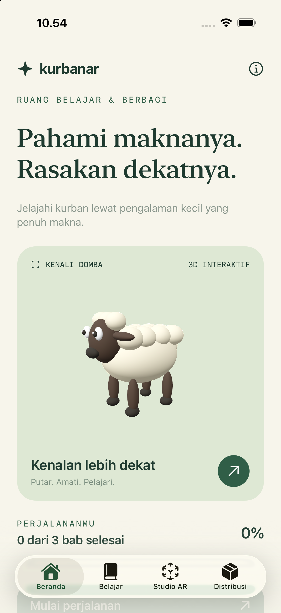

# KurbanAR

**Pahami maknanya. Rasakan dekatnya.**

An Indonesian, offline-first iPhone and iPad prototype exploring kurban through care, preparation, interactive 3D, and sharing. Built with SwiftUI, RealityKit, and ARKit. No third-party dependencies, accounts, analytics, or downloaded 3D assets.



## Try it

1. Open `KurbanAR.xcodeproj` in Xcode 16 or newer (iOS 17+ deployment target).
2. Select the **KurbanAR** scheme and an iPhone/iPad simulator; run.
3. For camera AR, select an ARKit-compatible physical device and configure your own signing team in Signing & Capabilities.

The simulator provides interactive 3D. Camera AR is available only on compatible physical devices, after camera permission is granted. Move the camera slowly to detect a horizontal plane, tap to place the sheep, pinch to resize, and use two fingers to rotate. Use **Letakkan ulang** to place it again.

## Prototype features

- Warm cream and forest-green SwiftUI interface with responsive iPad content widths.
- Three short learning chapters with questions, feedback, and persistent local progress.
- Original procedural sheep rendered in RealityKit, both in 3D preview and camera AR.
- Explicit camera consent, denied-permission handling, session interruption feedback, and preview fallback.
- Distribution calculator using integer grams: equal package weight plus a visible remainder.
- In-app privacy explanation and links to further reading.

## Validation

```sh
swift test
xcodebuild -project KurbanAR.xcodeproj -scheme KurbanAR \
  -destination 'generic/platform=iOS Simulator' CODE_SIGNING_ALLOWED=NO build
```

To run the UI smoke tests, use Product → Test in Xcode with the KurbanAR scheme and an iPhone simulator.

Core tests cover conservation of total weight, remainder bounds, invalid inputs, and progress persistence. See [verification notes](docs/VERIFICATION.md) for device-specific checks.

## Structure

```text
KurbanAR/App/          Entry point, shared UI, navigation
KurbanAR/Features/     Home, learning, studio, distribution
KurbanAR/AR/           Procedural model and AR session integration
Sources/KurbanCore/   Learning content, progress, distribution logic
Tests/                Swift Testing domain tests
UITests/              XCUITest navigation and persistence smoke tests
docs/                 Privacy, editorial and release preparation
```

The Xcode target compiles the core source files directly; the Swift package exposes the same sources for standalone tests.

## Editorial status

This is an early personal portfolio prototype, **not a released App Store product**. Content requires review by qualified religious and animal-health reviewers before public distribution. The sheep is illustrative and cannot assess animal eligibility, age, health, or real-world dimensions. Distribution numbers are arithmetic exercises using ready-to-pack meat, not live-animal yield estimates or religious allocation rules.

There are no depictions of slaughter. The focus is care, organization, and sharing. See [release preparation](docs/RELEASE.md) and [privacy](docs/PRIVACY.md).

## Further reading

- [Kemenag: preparing kurban distribution](https://dki.kemenag.go.id/berita/panitia-qurban-kankemenag-jakarta-utara-matangkan-distribusi-daging-kurban-pEvCv)
- [Kementan: animal welfare guidance](https://repository.pertanian.go.id/server/api/core/bitstreams/36d3973f-8871-4070-80d4-8a5b763cda69/content)
- [Apple App Review Guidelines](https://developer.apple.com/app-store/review/guidelines/)

These are background reading, not endorsements or evidence of expert approval.
